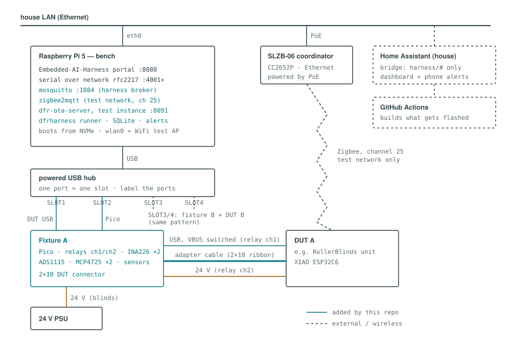
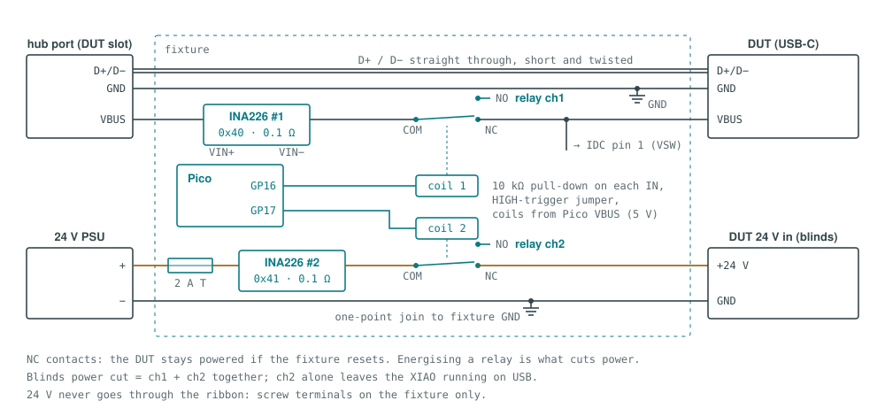
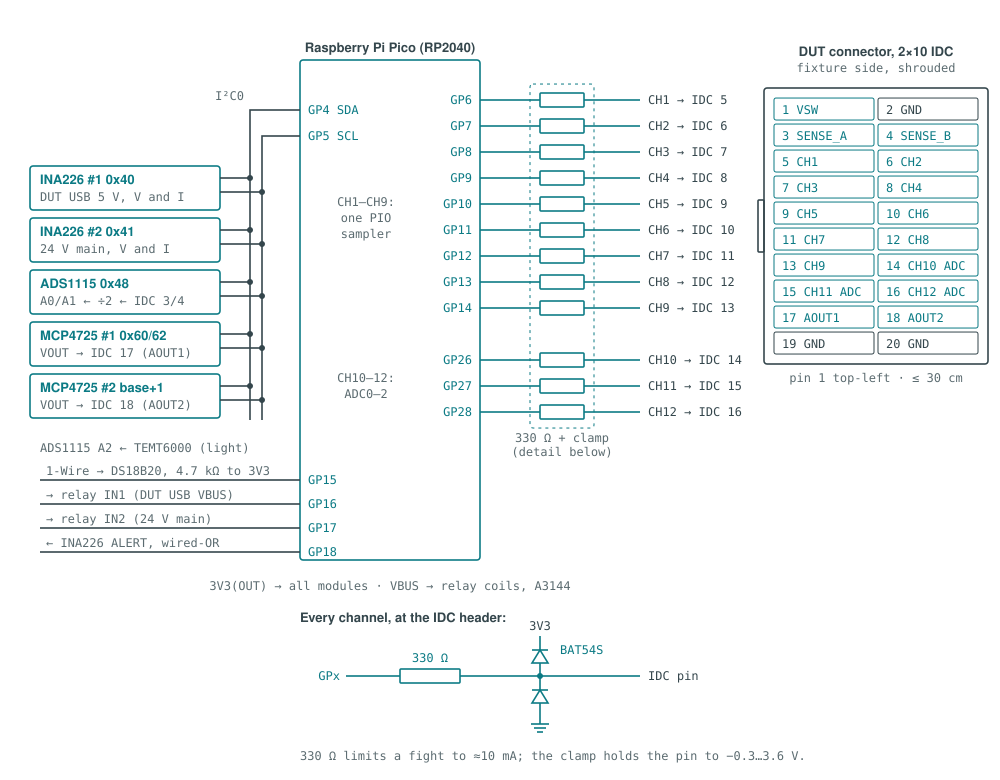
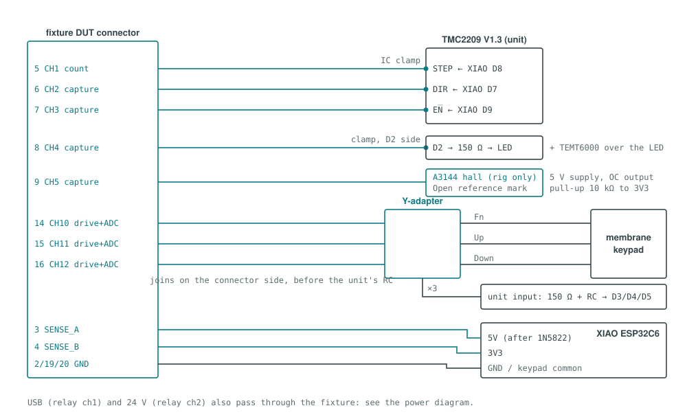

# Hardware & Wiring — DFR-test-harness

**Revision 0 (design, 2026-10-11).** This is the wiring reference for the
bench Pi, the per-DUT **fixture** (Pico + support modules), the standard
2×10 **DUT connector**, and the per-project **adapter cables**. Nothing here
has been built yet. Every number that still needs confirming on the bench is
flagged **(unverified)**; don't treat those as settled until measured. Once
fixture v1 is built and checked, bump the revision and remove the flags it
clears.

Architecture and test design: [docs/DESIGN.md](docs/DESIGN.md).
Where to buy each part: [docs/HARDWARE-SHOPPING.md](docs/HARDWARE-SHOPPING.md).

## Wiring diagrams

The bench, with this repo's additions in teal:



**The diagrams are generated.** `docs/wiring/build.py` is the master copy.
It writes `docs/wiring/wiring-diagram.html` (all diagrams on one page, light
and dark theme) and the standalone SVGs embedded in this document. Change
the drawing in `build.py`, run `python3 docs/wiring/build.py`, and commit the
regenerated files together with the wiring change they describe. The style
(palette, IBM Plex fonts, IEC symbols, teal for what's added) matches the
DFR-RollerBlinds wiring diagrams.

Three rules hold everywhere in this document:

1. **Every DUT signal the fixture touches is 3.3 V logic.** 5 V and 24 V
   rails reach only the INA226s (bus voltage, up to 36 V) or the ADS1115
   through ÷2 dividers. Nothing above 3.3 V ever reaches a Pico pin.
2. **24 V never goes through the ribbon.** It uses screw terminals on the
   fixture.
3. **The relays fail safe.** The DUT is powered through the **normally
   closed** contacts. If the Pico resets, loses USB or crashes, the DUT keeps
   running, and a soak isn't killed by a fixture glitch. Energising a relay
   is what *cuts* power.

## Bill of materials

Per fixture unless noted. Supplier links are in
[HARDWARE-SHOPPING.md](docs/HARDWARE-SHOPPING.md).

| Part | Role |
|---|---|
| Raspberry Pi 5 (4/8 GB) + 27 W PSU + Active Cooler + M.2 HAT+ with 256 GB NVMe (**one per bench**) | Runs the Embedded-AI-Harness portal, mosquitto, zigbee2mqtt, test dfr-ota-server and the runner. Boots from NVMe, because weeks of logs wear out SD cards |
| Powered USB hub, 4–7 ports (**one per bench**) | One port = one bench slot. Each DUT needs two (DUT + its fixture Pico) |
| SMLIGHT SLZB-06 (CC2652P), PoE, plus a PoE injector (**one per bench**) | Zigbee coordinator over Ethernet; see [Coordinator placement](#coordinator-placement) |
| Raspberry Pi Pico (RP2040), headered | Fixture controller: µs edge capture, step counting, open-drain input drive, ADC |
| INA226 module ×2 (0.1 Ω shunt) | #1 DUT USB 5 V current/voltage; #2 24 V main current/voltage (blinds) |
| ADS1115 module | Rail sense (`SENSE_A`, `SENSE_B`), light sensor, one spare input |
| MCP4725 module ×2 | Analog stimulus `AOUT1`/`AOUT2` (sensor and battery simulation) |
| 2-channel relay module, opto-isolated, 3.3 V logic, jumper-selectable trigger (Micro Robotics `REL-2CHAN-335V`) | ch1 cuts the DUT's USB VBUS, ch2 cuts 24 V main |
| 2×10 shrouded box header (fixture side) + 20-way IDC crimp sockets + ribbon | The [DUT connector](#dut-connector-210-idc) |
| 12 × 330 Ω, 12 × BAT54S (or 3.3 V clamp pairs), 2 × 10 kΩ pull-down, 1 × 4.7 kΩ, 4 × 10 kΩ 1 % | [Channel protection](#channel-protection), relay input pull-downs, 1-Wire pull-up, ÷2 sense dividers |
| USB cable to cut (A-male → C-male, data-capable) | The DUT's power and data cable through the fixture; see [DUT USB VBUS switch](#dut-usb-vbus-switch-relay-ch1) |
| 2 A slow-blow fuse + inline holder, 3 × 2-pin 5 mm screw terminals | 24 V path |
| Perfboard ≈ 10 × 15 cm, headers, 22–24 AWG hookup wire | Fixture v1 carrier (PCB in v2) |
| TEMT6000 light module, A3144E hall sensor + magnet, DS18B20 probe | [Sensors](#sensors) (per project as needed) |
| Micro IC clamp test hooks (10-pack) | Tapping hand-built units without soldering; see [Adapter: DFR-RollerBlinds](#adapter-dfr-rollerblinds) |
| *Optional:* USB logic analyzer (24 MHz 8-ch), Nordic PPK2 | Glitch deep-dives; µA sleep-current profiling |

## Recommended bring-up order

Build and prove each stage before connecting the next. The fixture checks
itself before it's ever trusted to check a DUT.

1. **Bench Pi alone.** Pi OS Lite 64-bit on NVMe, Ethernet, run the
   Embedded-AI-Harness `pi/install.sh`. Plug a bare XIAO into the hub:
   `curl http://$BENCH:8080/api/devices` lists it, and
   `pio run -t upload --upload-port rfc2217://$BENCH:4001` flashes it.
2. **Coordinator and Zigbee stack.** SLZB-06 on PoE, zigbee2mqtt (from
   `compose/`, phase 1) connects to it over TCP. Pair a known-good DFR unit.
3. **Bare Pico.** Flash the fixture firmware and plug it into a slot. It
   answers `{"cmd":"hello"}` on its USB port.
4. **I²C modules, one at a time.** Add each module and run an I²C scan
   after each. Expected addresses are in [I²C bus](#ic-bus-and-addresses).
   Adding them one at a time shows exactly which module is missing or
   clashing.
5. **Relays, no load.** Each relay clicks when commanded. With a
   multimeter, check NC is closed and NO open at rest, and the reverse when
   energised. Unplug and replug the Pico's USB: the relays must **not**
   click during boot (see [Relay drive](#relay-drive)).
6. **Power paths with a dummy load.** A 10 Ω 5 W resistor on the 5 V
   output (≈0.5 A) and a 100 Ω 10 W resistor on the 24 V output (≈0.24 A).
   The INA226 readings must match a multimeter within 2 %.
7. **Loopback plug.** Fit the [loopback plug](#loopback-self-test-plug) and
   run `dfrh fixture selftest`. Every channel, both DACs and both sense
   inputs pass.
8. **DUT via its adapter.** Only now connect a real unit, and run the
   commissioning smoke tier (DESIGN §7.1).

## Bench Pi

### USB slots and hub

The bench maps each **physical hub port** to a slot (`SLOT1`…`SLOTn`, RFC2217
port 4001 + slot index). A board keeps its slot as long as it stays in the
same port, so **label the hub ports** and keep each DUT and its fixture in
fixed ports. `/etc/dfrharness/bench.yaml` pairs them, for example SLOT1 DUT
with SLOT2 fixture.

* Use a hub with **its own power supply**. Several C6 boards transmitting
  plus Picos and relay coils will brown out a bus-powered hub.
* Use **data** cables. A charge-only cable is the most common cause of
  "device not detected" (upstream troubleshooting table).
* The DUT's USB cable runs **through the fixture** (relay ch1), not straight
  into the hub. The data lines pass straight through; only VBUS is switched.

### Coordinator placement

The bench's udev rule claims **every** `ttyUSB*`/`ttyACM*` device as a slot.
That includes a USB Zigbee dongle and the SLZB-06's own USB-C port, which also
presents a serial device.

* Connect the SLZB-06 by **Ethernet** and power it by **PoE** (or by a
  plain USB charger). Never plug it into the Pi or the slot hub.
* Place it 1–3 m from the DUTs. Not right next to them (receiver overload
  makes LQI meaningless), and not in another room.
* Keep it at least 1 m from the Pi 5, because the Pi's own WiFi test AP is
  also on 2.4 GHz. z2m uses **Zigbee channel 25**; keep the AP and house
  WiFi on channel 1 or 6 (DESIGN §3.2).

### Pi GPIO (optional)

The C6 boards (XIAO, FireBeetle 2) reset and enter download mode over their
built-in USB-Serial-JTAG, so **no Pi GPIO wiring is needed for them**. The
upstream bench's EN/BOOT lines (BCM 17 → EN, BCM 18 → BOOT, both
open-drain) are only for boards with a USB-UART bridge. All DUT signals
go through the fixture, never directly to the Pi's header.

## Power chain



```
hub port VBUS ──► INA226#1 VIN+ ─► VIN− ──► relay ch1 COM ─► NC ──► DUT USB-C VBUS
                   (shunt 0.1 Ω)                                     │
                                                                     └──► IDC pin 1 (VSW)
hub port GND  ────────────────────────────────────────────────────────── DUT USB GND, fixture GND
hub port D+/D− ─────────────── straight through (short, twisted) ─────── DUT USB D+/D−

24 V PSU + ─► 2 A fuse ─► INA226#2 VIN+ ─► VIN− ─► relay ch2 COM ─► NC ─► 24 V OUT terminal ─► DUT 24 V in
24 V PSU − ─────────────────────────────────────────────────────────────► 24 V OUT − ─► DUT GND
                                     (also tied to fixture GND, one point)
```

### Fixture power

The Pico is powered from **its own** USB slot (VBUS → VSYS through its
on-board diode). All I²C modules and the TEMT6000 run from the Pico's
**3V3(OUT)** (pin 36). The total stays well under its ≈300 mA budget:
INA226 ×2, ADS1115 and MCP4725 ×2 are each about a milliamp. The relay
module's coil supply (`JD-VCC`/`VCC`, 5 V) and the A3144 hall sensor run
from the Pico's **VBUS** (pin 40).

### DUT USB VBUS switch (relay ch1)

Each DUT is powered by USB (and on the blinds also by the buck through the
1N5822). A power-cut test therefore has to break **USB VBUS**, or the DUT
stays up on USB. Cut the VBUS (red) wire of the DUT's USB cable and route it
through INA226 #1 and relay ch1 NC. Leave the other three wires (GND,
D+, D−) intact, twisted, and as short as you can.

* While ch1 is energised, the DUT's USB port disappears from the bench. That
  is expected. The bench re-detects it in the same slot when power returns.
  The runner waits for the slot before reading serial again.
* For DUTs that take 5 V through the DUT connector instead of USB, the same
  switched rail is on IDC pin 1 (`VSW`). Its limits are ≤ 1 A and the hub
  port's current limit.

### 24 V main path (relay ch2)

Blinds only (any future 24 V project too). Fuse first, then the INA226 #2
shunt, then relay ch2 NC, then the output terminal.

* The INA226's default 0.1 Ω shunt gives ±0.82 A full scale. The blinds draw
  well under that at 24 V **(unverified; measure on first build)**. If a
  future project draws more, change the shunt to 0.01 Ω (±8.2 A) and update
  the calibration value in the profile.
* Join 24 V − to fixture GND at **one point** on the fixture board, next to
  the INA226 #2 ground. The DUT already joins them through its own buck.
  A second joint makes a ground loop through the ribbon.
* For a blinds "power cut mid-move", energise **ch1 and ch2 together**.
  Cutting 24 V alone leaves the XIAO running on USB, which tests something
  else (motor supply loss with the controller alive). That's also worth a
  test, but don't confuse the two.

### Relay drive

Set both trigger jumpers on the relay module to **HIGH-level trigger**, and
fit a **10 kΩ pull-down** from each `IN` to GND on the fixture board. At
power-up and during Pico reset the GPIOs float; the pull-downs hold them low,
so the relays stay off and the DUT stays powered through NC. In LOW-trigger
mode a floating input or a dead Pico could energise the relay and cut DUT
power, which is exactly the failure the NC wiring is meant to avoid.

## Fixture Pico pin-by-pin wiring



### Pico pin table

| Pico pin | GPIO | Function | Goes to |
|---:|---|---|---|
| 6 | GP4 | I²C0 SDA | INA226 #1, INA226 #2, ADS1115, MCP4725 ×2 |
| 7 | GP5 | I²C0 SCL | (same) |
| 9 | GP6 | **CH1** | 330 Ω → IDC 5 |
| 10 | GP7 | **CH2** | 330 Ω → IDC 6 |
| 11 | GP8 | **CH3** | 330 Ω → IDC 7 |
| 12 | GP9 | **CH4** | 330 Ω → IDC 8 |
| 14 | GP10 | **CH5** | 330 Ω → IDC 9 |
| 15 | GP11 | **CH6** | 330 Ω → IDC 10 |
| 16 | GP12 | **CH7** | 330 Ω → IDC 11 |
| 17 | GP13 | **CH8** | 330 Ω → IDC 12 |
| 19 | GP14 | **CH9** | 330 Ω → IDC 13 |
| 20 | GP15 | 1-Wire | DS18B20 data, 4.7 kΩ pull-up to 3V3 |
| 21 | GP16 | Relay ch1 `IN1` | relay module, 10 kΩ pull-down |
| 22 | GP17 | Relay ch2 `IN2` | relay module, 10 kΩ pull-down |
| 24 | GP18 | INA226 `ALERT` (both, wired-OR) | over-current trip input, 10 kΩ pull-up to 3V3 |
| 31 | GP26 / ADC0 | **CH10** | 330 Ω → IDC 14 |
| 32 | GP27 / ADC1 | **CH11** | 330 Ω → IDC 15 |
| 34 | GP28 / ADC2 | **CH12** | 330 Ω → IDC 16 |
| 33 | AGND | Analog ground | ADS1115 GND, DAC GNDs, sense divider grounds |
| 36 | 3V3(OUT) | 3.3 V for modules | INA226 ×2, ADS1115, MCP4725 ×2, TEMT6000, DS18B20, pull-ups |
| 40 | VBUS | 5 V from the Pico's USB | relay module `VCC`/`JD-VCC`, A3144 supply |
| 3, 8, 13, 18, 23, 28, 38 | GND | Ground | Fixture ground plane / bus, IDC 2, 19, 20 |
| 1, 2 | GP0, GP1 | spare (UART0 debug) | — |
| 4, 5, 25–27, 29 | GP2, GP3, GP19–22 | spare | — |

CH1–CH9 are **consecutive GPIOs (GP6–GP14)**, so one PIO state machine
samples all nine in a single read. CH10–CH12 are the RP2040's only three ADC
inputs (GP26–28), and a second state machine samples them digitally when
they aren't in `adc` mode.

The firmware's view, the counterpart of the blinds' GPIO block in `main.c`:

```c
/* ---- fixture GPIO map: Raspberry Pi Pico (RP2040) ---- */
#define FX_I2C_SDA      4
#define FX_I2C_SCL      5
#define FX_CH_BASE      6      /* CH1..CH9 = GP6..GP14, one PIO sampler */
#define FX_CH_DIGITAL_N 9
#define FX_CH10_GPIO    26     /* ADC0 */
#define FX_CH11_GPIO    27     /* ADC1 */
#define FX_CH12_GPIO    28     /* ADC2 */
#define FX_ONEWIRE      15
#define FX_RELAY1       16     /* high = energised = DUT USB VBUS CUT */
#define FX_RELAY2       17     /* high = energised = 24 V main CUT */
#define FX_INA_ALERT    18     /* active low, wired-OR from both INA226 */
```

### I²C bus and addresses

| Module | Address | Set by |
|---|---|---|
| INA226 #1 (DUT USB 5 V) | `0x40` | A0 = GND, A1 = GND |
| INA226 #2 (24 V main) | `0x41` | A0 = VS, A1 = GND |
| ADS1115 | `0x48` | ADDR = GND |
| MCP4725 #1 (`AOUT1`) | base | A0 = GND |
| MCP4725 #2 (`AOUT2`) | base + 1 | A0 = VCC |

The MCP4725 **base address depends on the module**: `0x60` on most generic
boards, `0x62` on Adafruit's. The fixture firmware scans `0x60`–`0x63` at
boot and reports what it finds. Run at 100 kHz to start; every module
brings its own pull-ups, and five sets in parallel (≈2 kΩ) is fine at 3.3 V.
If the bus is unreliable, remove the pull-ups from all but one module.

### Channel protection

Every channel, between the Pico pin and the IDC pin:

```
Pico GPx ──●── 330 Ω ──●── IDC pin
           │           │
           │      BAT54S (to 3V3 and GND)
```

* The 330 Ω limits current if a channel is driven against a DUT output, or
  if a wiring mistake connects it to something live. At 3.3 V into a 0 V
  short that's 10 mA, which is safe for both sides.
* The BAT54S clamps the IDC side to between −0.3 V and 3.6 V. The input-side
  clamp is what saves the Pico if an adapter cable is plugged in one pin off
  and lands on a 5 V pin.
* Keep the 330 Ω **close to the IDC header**, so the ribbon's capacitance
  is on the far side of it.

**Open-drain key drive check (blinds key line).** The fixture pulls the key
line low through 330 Ω, after the blinds' own 150 Ω and against its 4.7 kΩ
pull-up. Voltage at the XIAO pin: 3.3 V × (330 + 150) / (4700 + 330 + 150)
≈ **0.31 V**. That is well under the C6's V_IL (0.25 × VDD ≈ 0.83 V), so
the press registers cleanly. The internal ≈45 kΩ pull-up in parallel
changes it by less than 0.03 V.

### Sense dividers

`SENSE_A` and `SENSE_B` (IDC 3 and 4) each go through a **10 kΩ / 10 kΩ
1 %** divider to ADS1115 A0 / A1. That gives up to 6.6 V full scale at the
ADS1115's ±4.096 V range, enough for a 5 V rail. **Never connect 24 V to a
sense pin**; 24 V is read by INA226 #2's bus input. The divider ratio is
calibrated once with the loopback plug (`VSW` → `SENSE_A`) and stored in
`/etc/dfrharness/fixtures/<id>.yaml`.

ADS1115 A2 = TEMT6000 output (light). A3 = spare.

## DUT connector (2×10 IDC)

Fixture side: a **shrouded** 2×10 box header, so a cable can't go in
reversed. Pin 1 is marked on the fixture silkscreen or with a paint dot.

| Pin | Signal | Pin | Signal |
|---:|---|---:|---|
| 1 | `VSW` switched 5 V (relay ch1, ≤1 A) | 2 | GND |
| 3 | `SENSE_A` (÷2 → ADS1115 A0) | 4 | `SENSE_B` (÷2 → ADS1115 A1) |
| 5 | CH1 | 6 | CH2 |
| 7 | CH3 | 8 | CH4 |
| 9 | CH5 | 10 | CH6 |
| 11 | CH7 | 12 | CH8 |
| 13 | CH9 | 14 | CH10 (ADC) |
| 15 | CH11 (ADC) | 16 | CH12 (ADC) |
| 17 | `AOUT1` (MCP4725 #1) | 18 | `AOUT2` (MCP4725 #2) |
| 19 | GND | 20 | GND |

* **Cable length ≤ 30 cm.** The fixture measures noise on the DUT's
  signals, so the ribbon must not add much of its own. In a ribbon, the
  conductor next to each signal is another signal. Where it matters (key
  lines on CH10–12), the adapter end should run a twisted pair per signal
  with its return to IDC 19/20.
* `AOUT1`/`AOUT2` can drive about 25 mA at most and are not buffered. They
  are fine into an ADC input or a sensor's output node. They **cannot power
  anything**. Battery simulation means feeding the DUT's battery-sense node,
  not replacing the battery (see [Adapter: DFR-MoistureTracker](#adapter-dfr-moisturetracker)).

### Loopback self-test plug

A 20-way IDC socket with these links, used in [bring-up](#recommended-bring-up-order)
step 7 and before every long soak:

| Link | Proves |
|---|---|
| CH1↔CH2, CH3↔CH4, CH5↔CH6, CH7↔CH8 | Each channel drives and captures. Each pair is tested both ways |
| CH9 ↔ CH10 | Digital-to-ADC-capable path |
| `AOUT1` ↔ CH11, `AOUT2` ↔ CH12 | Both DACs and both ADC channels (sweep 0–3.0 V, linearity) |
| `VSW` ↔ `SENSE_A` | Relay ch1, INA226 #1 voltage, divider calibration |
| `SENSE_B` → GND | ADS1115 zero |

## Sensors

| Sensor | Wiring | Notes |
|---|---|---|
| **TEMT6000** light | VCC → 3V3, GND → AGND, OUT → ADS1115 A2 | Tape it over the DUT's status LED with a short opaque sleeve, so room light doesn't count. Threshold is set per unit in the profile (**unverified**) |
| **A3144E** hall (blinds Open reference) | VCC → **VBUS 5 V** (it needs 4.5–24 V and won't run at 3.3 V), GND, OUT (open collector) → 10 kΩ to **3V3** → a free channel (CH5 in the blinds profile) | Open-collector output pulled up to 3V3, so the channel never sees 5 V. Glue a 5 mm magnet to the roller tube or gear, and set the sensor 2–4 mm away |
| **DS18B20** | VDD → 3V3, GND, DQ → GP15 with 4.7 kΩ to 3V3 | Clip to the TMC2209 heatsink or buck with thermal tape. Several can share GP15 |
| **USB logic analyzer** (optional) | Its own USB into the Pi (not the slot hub), probes on the IDC side of the 330 Ω | sigrok `fx2lafw`; 5.25 V max input |
| **Nordic PPK2** (optional) | Source-meter mode, inserted in place of `VSW`/battery for the DUT | Its own USB into the Pi. µA sleep profiling for battery projects |

## Adapter: DFR-RollerBlinds



Pin numbers come from `DFR-RollerBlinds/src/main.c` (v2.4.0 pin map) and the
profile in DESIGN §6. Tap the **unit's own connectors and the driver's
pins**, not the XIAO header. The point is to check the hand-soldered joints
and harness, not to bypass them.

| IDC | Fixture ch | Mode | Blinds signal | XIAO pin | Where to tap |
|---:|---|---|---|---|---|
| 5 | CH1 | `count` | STEP | D8 / GPIO19 | TMC2209 `STEP` pin (micro IC clamp) |
| 6 | CH2 | `capture` | DIR | D7 / GPIO17 | TMC2209 `DIR` pin |
| 7 | CH3 | `capture` | EN̅ | D9 / GPIO20 | TMC2209 `EN` pin |
| 8 | CH4 | `capture` | LED | D2 / GPIO2 | LED anode side of its 150 Ω (clamp on the resistor lead) |
| 9 | CH5 | `capture` | Hall (Open reference) | — | A3144 output (rig only) |
| 14 | CH10 | `open_drain` + `adc` | Key **Fn** | D3 / GPIO21 | Keypad connector, Fn line (key side of the 150 Ω) |
| 15 | CH11 | `open_drain` + `adc` | Key **Up** | D4 / GPIO22 | Keypad connector, Up line |
| 16 | CH12 | `open_drain` + `adc` | Key **Down** | D5 / GPIO23 | Keypad connector, Down line |
| 3 | `SENSE_A` | ADS1115 | 5 V after the 1N5822 | XIAO 5V pin | XIAO 5V pin / diode cathode |
| 4 | `SENSE_B` | ADS1115 | 3V3 rail | XIAO 3V3 pin | XIAO 3V3 pin |
| 2, 19, 20 | GND | — | GND | XIAO GND | Keypad common / XIAO GND |
| — | 24 V terminals | INA226 #2 + relay ch2 | 24 V main | — | Between the PSU and the unit's 24 V input |
| — | USB | INA226 #1 + relay ch1 | XIAO USB | USB-C | The DUT's USB cable through the fixture |

* **Keypad:** use a **Y-adapter** on the keypad tail connector, so the
  membrane stays attached and you can still press keys by hand. The fixture
  lines join the keypad lines on the connector side, which puts them through
  the unit's 150 Ω and RC front-end just like a real press.
* **What the fixture measures on the key lines.** The ADC on CH10–12 sees
  the lead **before** the RC filter, which is the raw coupled noise. The
  firmware's `TRC_KEY_SWALLOWED`/`TRC_KEY_EDGE` telemetry sees it **after**
  the filter. Both are recorded, and the difference is the margin the RC
  front-end and `key_filter` provide.
* **The fixture changes the unit, a little.** The adapter adds about 30 cm
  of lead and a 330 Ω path to a quiet ground on each key line. That can make
  noise slightly *better* than on an installed unit. For the
  [worst-case noise rig](docs/DESIGN.md#74-noise-and-phantom-suite-g1), also
  run with the key-line adapter **disconnected**, relying on firmware
  telemetry alone, and compare.
* For a permanent bench unit, solder a 2×10 header to a small strip board
  in the enclosure instead of using clamps.

## Adapter: DFR-DoorSensor

From `DFR-DoorSensor/src/main.c`: `DOOR_CONTACT_GPIO 5`. The FireBeetle 2 C6
is powered by USB through the fixture (relay ch1). There's no 24 V.

| IDC | Fixture ch | Mode | Signal | Where to tap |
|---:|---|---|---|---|
| 14 | CH10 | `open_drain` + `adc` | Reed contact | Contact connector, across the reed (in parallel with it, or with the reed removed) |
| 4 | `SENSE_B` | ADS1115 | 3V3 | FireBeetle 3V3 |
| 2, 19, 20 | GND | — | GND | FireBeetle GND |

Polarity, from `main.c` (`DOOR_CONTACT_ACTIVE_LOW 0`) and `door_contact.c`:
GPIO5 has the internal pull-up enabled, and a **closed** door shorts it to
GND. So the fixture **pulls CH10 low = door closed** and **releases it = door
open**, the same open-drain drive as a key. Chatter tests drive CH10 with
bursts of edges at a few kHz to exercise the debounce.

## Adapter: DFR-MoistureTracker

Phase 8, **to be designed**. The constraints below are already known:

* **Power:** the battery is **removed**. The board is powered from the PPK2
  (source-meter, set to the battery voltage) on its battery input, for µA
  profiling. Or it's powered from USB through the fixture when sleep current
  doesn't matter.
* **Battery-voltage simulation** (`AOUT2`) goes into the **battery-sense
  divider node** only, never the battery terminal. Check the FireBeetle's
  divider (`battery_monitor.c`: ADC1 channel 0 / GPIO0) and scale `AOUT2`
  to what the divider would output.
* **Soil sensor simulation** (`AOUT1`) replaces the sensor's analog output
  at the sensor connector, with the real sensor disconnected.
* WiFi side (config portal, MQTT publisher): uses the bench's WiFi test AP.
  No extra wiring.

## Commissioning a new fixture

Before a fixture is first trusted, and after any repair:

- [ ] Bring-up steps 3–7 above all pass
- [ ] Relays stay off through a Pico unplug/replug (no click)
- [ ] INA226 #1 and #2 within 2 % of a multimeter at the dummy loads
- [ ] Loopback self-test passes. The calibration file is written to
      `/etc/dfrharness/fixtures/<id>.yaml`
- [ ] Fixture ID label on the board, the same `<id>` as in `bench.yaml`
- [ ] 24 V fuse fitted, terminals torqued, one-point 24 V − / GND joint
      checked for continuity
- [ ] Photo of the finished board in `hardware/fixture-v1/` (with the
      revision)

## Troubleshooting

### A module is missing from the I²C scan

Check whether it's the module or the bus:
* unplug every module except the missing one, and check SDA/SCL (GP4 to
  SDA, GP5 to SCL, not swapped) and 3V3 at the module;
* MCP4725: scan the whole `0x60`–`0x63` range (the base address varies by
  module);
* two INA226s on the same address (both A0/A1 strapped to GND) clash and
  both disappear.

### A relay clicks when the Pico boots, or the DUT loses power at fixture reset

The trigger jumper is on LOW or a pull-down is missing. Set HIGH trigger and
fit 10 kΩ from each `IN` to GND (see [Relay drive](#relay-drive)). Also
check the DUT is wired to **NC**, not NO.

### The DUT keeps running through a "power cut"

It's still getting power another way:
* USB VBUS isn't going through relay ch1 (cable not routed through the
  fixture, or a second USB lead);
* on the blinds, only ch2 (24 V) was cut and the XIAO is running on USB.
  Cut both for a real power loss (see [24 V main path](#24-v-main-path-relay-ch2)).

### The DUT's slot disappears during a test

That's expected while relay ch1 is energised (USB VBUS cut). If it happens
*without* a commanded cut:
* the hub is overloaded (use a powered hub);
* or the DUT is browning out. Check the INA226 #1 voltage under radio and
  motor load.

### A commanded key press isn't seen by the DUT

Look at the line voltage and the ground:
* read the CH ADC while pressing: it should be under 0.5 V at the XIAO end;
* if it isn't, the fixture GND and DUT GND aren't common (IDC 2/19/20 not
  connected at the adapter);
* or the clamp is on the wrong side of the 150 Ω.

### Phantom key events appear only with the fixture connected

The adapter is adding coupling. Shorten it, twist each key line with a ground
return, and make sure the fixture's channel is **released** (high-Z), not
driven high. Then repeat with the key adapter unplugged (telemetry only) to
see whether the phantom is the unit's or the fixture's.

### The hall sensor never triggers

The A3144 is powered from 3V3 (it needs ≥ 4.5 V; use VBUS). Or the magnet
is the wrong pole or too far away (≤ 4 mm).

### INA226 reads about 0 A while the motor clearly runs

The shunt is wired in the GND return instead of the supply, or VIN+/VIN−
are swapped. It must be **high-side**, in the + lead, with VIN+ toward the
PSU.

## See also

* [docs/DESIGN.md](docs/DESIGN.md): architecture, profiles, test catalogue
* [docs/HARDWARE-SHOPPING.md](docs/HARDWARE-SHOPPING.md): parts and South African suppliers
* [DFR-RollerBlinds HARDWARE.md](https://github.com/linosteenkamp/DFR-RollerBlinds/blob/main/HARDWARE.md): the blinds unit itself (power chain, keypad RC front-end, TMC2209)
* [SensorsIot/Embedded-AI-Harness](https://github.com/SensorsIot/Embedded-AI-Harness): the bench (User Manual §2 install, §17 troubleshooting)
